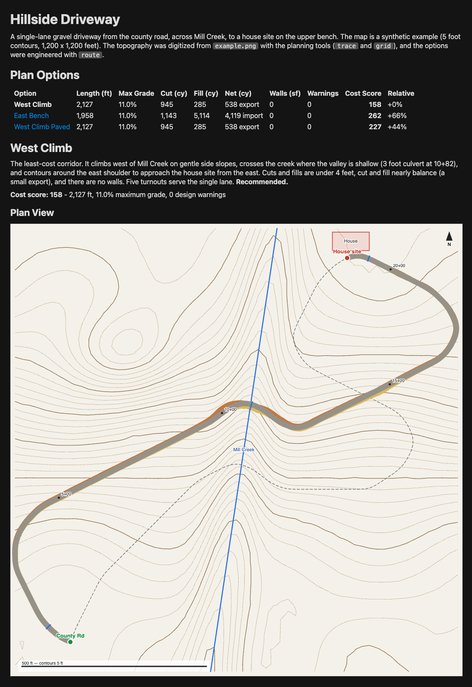

# Roadie

Roadie engineers low-volume roads (driveways, rural access roads, and forest roads) from a
topographic map image, and views the resulting road grading plans in 3D.

- **`make plan FILE=<plan.png> [OUTPUT=<plan.json>]`** launches a Claude Code session with detailed
  road engineering instructions ([PLAN.md](PLAN.md)). Claude digitizes the map's topography, engineers
  one or more cost-optimal road plan options from the labeled start point to the labeled end point,
  and writes the road plan model (`OUTPUT`, default `<plan>.json`).
- **`make update FILE=<plan.json>`** launches a Claude Code session that
  updates an existing road plan model with review feedback (from the city or county, a surveyor, or
  the owner, for example).
- **`make run FILE=<plan.json>`** opens the road plan model in the Roadie viewer, a
  [MarkdownUp](https://github.com/craigahobbs/markdown-up) application written in
  [BareScript](https://github.com/craigahobbs/bare-script).




## The viewer

The viewer's report - meant to be read and printed - computes each option's earthwork, structures,
and cost score, then shows:

- **Plan options** - a comparison of every option's length, maximum grade, cut, fill, net import or
  export, retaining walls, design warnings, and cost score (select an option to view it)
- **Plan view** - a contour map with the road footprint (cut and fill slopes), structures, station
  ticks, the other options' centerlines, and the outlines of the 3D views. Click it to explore the 3D
  landscape from that point.
- **Profile** - the ground and road grade along the road, with cut and fill areas, structures, and
  grades over the maximum highlighted
- **3D views** - the terrain (with contours) graded to the road's finished surface: the road, cut and
  fill slopes, retaining walls, bridges, culverts, streams, station labels, and other features. The
  first view is always the whole site. When the road is too narrow to see in it (or the terrain hides
  parts of it), views of equal road segments follow, from the start to the end. Every view keeps the
  overview's general orientation, so the reader stays oriented across the views. Each looks across its
  road segment - preferably upslope, where the road's cuts into the hillsides and its fill slopes face
  the viewer - at the lowest tilt that shows all of its road.
- **Cost** - the cost breakdown by item
- **Design warnings** - grades over the maximum, curves under the minimum radius, slopes that don't
  daylight (retaining walls needed), walls over the maximum height, unprotected stream crossings,
  exclusion areas, and ends that miss the start/end points or don't tie in to the ground
- **Structures** and the **source map** image

The "Terrain" links above the 3D views draw the terrain "Faceted" (the default - the plan's elevation
grid) or "Smooth" (where a view is zoomed in past the grid, each grid cell is divided into smaller
cells interpolated between the grid points, clamped to each grid cell's corner elevations). Smooth
terrain looks smoother up close but is no more accurate, and it makes the report slower and larger.
The explorer's links start with the report's terrain drawing.

On large sites, where the road is too narrow to see at a view's scale, the selected option's road is
also drawn as a highlighted centerline.

The report's "Explore" links open the full-window **3D explorer**, controlled with the keyboard:

| Keys | Action |
| --- | --- |
| Arrows or W A S D | Move left, right, forward, and back |
| + / - | Zoom in and out |
| Q / E or Shift+Left / Right | Rotate |
| Shift+Up / Down | Tilt - view more from above or from the side |
| R / F or Page Up / Down | Raise and lower the view |
| [ / ] | Less and more vertical exaggeration |
| G | Smooth or faceted terrain |
| T, N, 0 | Top view, face north, and reset |
| H | Show or hide the keyboard help |
| Esc | Back to the report |

`make run` with no `FILE` opens the viewer's home page, which links to the example plan.


## The cost score

The cost score is the estimated construction cost in thousands of nominal US dollars - for comparing
plan options, not as a bid estimate. Roadie computes it from typical 2023-2025 unit rates (state DOT
average bid prices and low-volume road references):

- **Earthwork** by the average end area method. Cross sections every third of a grid cell model the
  road template, cut slopes (1:1 soil, 0.5:1 rock), and fill slopes (1.5:1) against the ground's
  cross slope. Rock excavation applies within rock outcrop areas.
- **Mass balance** - shrinkage and swell, borrow (import), waste (export), and overhaul from the mass
  haul diagram beyond the free haul distance
- **Clearing, surfacing, ditches and cross drains, erosion control**, by area or length
- **Culverts, retaining walls (by face area), bridges (by deck area), and turnouts**
- **Existing road upgrades** (by area) - where an option follows an existing road, reshaping, a
  gravel lift, ditch cleaning, and minor widening replace the new road's earthwork, clearing,
  surfacing, and ditches
- **Mobilization** (10%)

A plan can override any unit rate (`costRates`) for local prices. See [PLAN.md](PLAN.md#appendix-the-cost-score)
for the default rates.


## Planning a road

```
make plan FILE=site.png
```

The map (an image or a PDF) must clearly label the road's start and end points and should include a
scale bar and contour interval. The Claude Code session follows [PLAN.md](PLAN.md), which covers reading the map,
digitizing the topography, design criteria, road engineering principles, generating and refining
options, and finalizing the model. It uses these tools:

- [tools/plan_tools.py](tools/plan_tools.py) - image inspection (`info`, `crop`), contour tracing
  (`trace`, `transect`), the topography grid (`grid`), plotting (`plot`), and road engineering
  (`route`, `profile`). `route` finds the least-cost horizontal alignment with a lattice search
  (radius-constrained turns, grade, side slope, stream crossing, rock, and exclusion costs), designs
  the vertical profile by dynamic programming (minimum earthwork within the grade limits, with flatter
  switchbacks), and places culverts, retaining walls, bridges, and turnouts.
- `make evaluate FILE=<plan.json> [DETAIL=1]` - the viewer's own analysis and cost score from the
  command line (with a station-by-station table), so the planner optimizes the same cost the viewer
  shows

The session writes `site.json`, with intermediate files in `site.work/`. Use `OUTPUT` to write the
model elsewhere - for example, to compare planning runs without overwriting earlier ones:

```
make plan FILE=site.png OUTPUT=site-run2.json
```

The intermediate files go next to the output (here, `site-run2.work/`).

The session uses the Opus model at high effort by default. Use `MODEL` and `EFFORT` to change them
(any Claude Code `--model` alias or name, and `--effort` level - `low`, `medium`, `high`, `xhigh`, or
`max`), for both `make plan` and `make update`:

```
make plan FILE=site.png MODEL=sonnet EFFORT=max
```

Use `OLLAMA=1` to run the session on a local or cloud [Ollama](https://ollama.com) model instead
(it launches Claude Code with `ollama launch claude`). `MODEL` then names the Ollama model; without
it, Ollama picks the model (prompting if needed):

```
make plan FILE=site.png OLLAMA=1 MODEL=qwen3.8:27b-mlx
```

Use `GROK=1` to run the session with the [Grok CLI](https://docs.x.ai/build/overview) (`grok`) instead of Claude Code.
`MODEL` then names the Grok model; without it, Grok uses its default model:

```
make plan FILE=site.png GROK=1 MODEL=grok-4.6
```


## Updating a plan

Plans often change after review - the city or county may require a 10% fire code grade, a property
line setback, or a larger culvert, and a surveyor may correct the topography. To update a plan, run:

```
make update FILE=site.json
```

The session asks for the feedback - paste it in, or give the path of a file that contains it. It
follows [Updating a plan](PLAN.md#updating-a-plan): it saves a dated copy of the plan in the work
directory (`site.work/`), restates each feedback item and how it will address it, updates the
criteria, site features, topography, or options (reusing the original session's digitized contours),
re-engineers and re-evaluates the affected options, and adds a revision history to the plan's
description. It finishes with a before-and-after comparison of the options.


## The road plan model

A road plan model is a JSON file containing the site topography (an elevation grid with streams, rock
outcrops, and exclusion areas), the start and end points, design criteria, cost rate overrides, and
one or more road plan options. Each option has a road cross section, a centerline alignment (x, y,
and grade elevation), and structures (retaining walls, bridges, culverts, turnouts, and the existing roads
it follows). Run
`make doc` for the model documentation (also linked from the viewer).


## The example

The [example](example/) is a synthetic hillside site. Its topography was digitized from
[example.png](example/example.png) with the planning tools, and its options were engineered with
`route`:

```
make run FILE=example/example.json
```


## Development

```
make commit       # run the BareScript tests (100% coverage), the planning tools tests, and lint
make test         # run the BareScript tests (TEST=testName runs one test)
make test-tools   # run the planning tools tests
make clean        # remove the build directory
```

| File | Purpose |
| --- | --- |
| [roadie.md](roadie.md), [roadie.bare](roadie.bare) | The viewer application and its 3D, plan, and profile drawings |
| [roadieModel.bare](roadieModel.bare) | The road plan model schema, validation, earthwork, and cost analysis |
| [roadieCLI.bare](roadieCLI.bare) | The command-line evaluator (`make evaluate`, `make doc`) |
| [PLAN.md](PLAN.md) | The road planning instructions for Claude Code |
| [CLAUDE.md](CLAUDE.md) | The repository guide for Claude Code |
| [tools/plan_tools.py](tools/plan_tools.py) | The planning tools |
| [test/](test/) | The BareScript unit tests |
